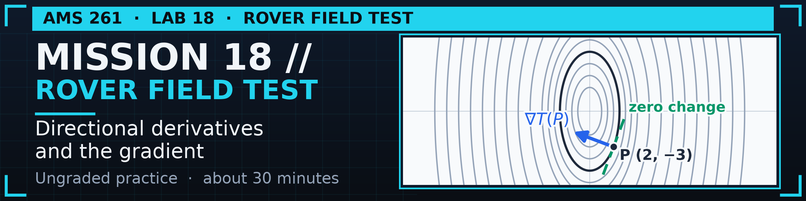
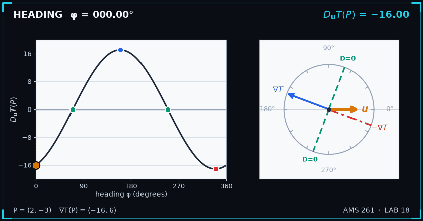

  

# AMS 261 Labs

Practice notebooks for AMS 261 (Multivariable Calculus) at SUNY Korea.
Each lab follows one lecture. It lets you predict, compute, plot and check the ideas of that lecture in Python.

## Labs

| Lab | Topic | Open |
|:---|:---|:---|
| Lab 18 | Directional Derivatives and the Gradient |   [Download](https://raw.githubusercontent.com/tancao1128/ams261-labs/main/labs/AMS261-Lecture18.ipynb) |

## Preview

In Lab 18, a heat-seeking rover sits on a metal plate. The temperature is T(x, y) = 20 − 4x² − y² (°C, with x and y in cm). At the point P = (2, −3), the gradient is ∇T(P) = ⟨−16, 6⟩. The animation turns the heading φ once around the compass. Left: the rate of change DuT(P) = −16 cos φ + 6 sin φ. Right: the gradient (blue), the opposite direction (red), the two zero-change headings (green) and the heading u (amber).

  

## How to open a lab

- **Colab (recommended).** Click the Colab badge. Sign in with a Google account. Choose *Runtime → Run all*, or run the cells one by one with Shift+Enter. To keep your work, choose *File → Save a copy in Drive*.
- **Binder.** Click the Binder badge. No account is needed. The first launch can take a few minutes. Binder does not save your work, so download the notebook before you close the tab.
- **Download.** Use the *Download* link (right-click → *Save link as…*). Open the `.ipynb` file in Jupyter or VS Code. You need Python 3 with the packages in `requirements.txt`.

## Ground rules

- **Labs are ungraded practice.** Nothing here counts toward your grade. Homework is submitted on Gradescope as usual.
- **AI use.** Each lab contains a short student AI contract and a verification rule in its *AI Learning Companion* section. If you use an AI tool, paste that contract first and follow it.

## License

© Tan H. Cao, for AMS 261 students. All rights reserved.
